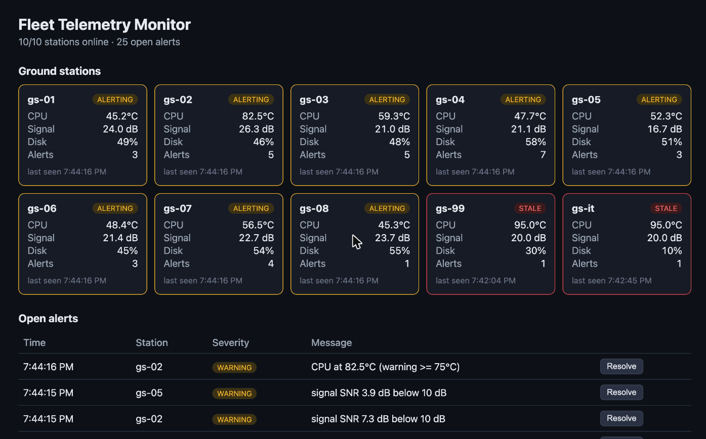

# Fleet Telemetry Monitor

A small platform for monitoring a fleet of remote ground stations. Stations send health
readings (CPU temperature, signal strength, disk usage, online status) to a Go API. Readings
flow through a Redis Stream to a processor that stores them in PostgreSQL, runs alert rules,
and exports Prometheus metrics. Operators watch the fleet in a React dashboard and in Grafana.



## Architecture

```
 stations / simulator
        │  POST /api/v1/telemetry  (bearer token)
        ▼
   ┌──────────┐   XADD    ┌──────────────┐  XREADGROUP  ┌────────────┐
   │ Go API   │ ────────▶ │ Redis Stream │ ───────────▶ │ processor  │ ──▶ PostgreSQL
   └──────────┘           └──────────────┘   (ack after  └────────────┘     (readings, alerts)
        │  GET /stations, /alerts             storing)        │
        ▼                                                     ▼
  React dashboard                                  Prometheus ──▶ Grafana
```

| Part | Tech | What it does |
|------|------|--------------|
| `cmd/server` | Go, `net/http` | REST API: validates and queues readings, serves station status and alerts, `/healthz`, `/readyz`, `/metrics` |
| `cmd/processor` | Go, Redis Streams | Consumer group worker: stores readings, evaluates alert rules, updates metrics |
| `cmd/simulator` | Go | Simulates N stations, injecting faults (overheating, weak signal, full disk, outages) |
| `internal/rules` | Go | Pure alert logic with configurable thresholds |
| `dashboard/` | React, TypeScript, Vite | Live fleet view and alert triage (resolve alerts) |
| `deploy/prometheus`, `deploy/grafana` | Prometheus, Grafana | Scraping, fleet-level alert rules, provisioned dashboard |
| `deploy/k8s` | Kubernetes | Deployments with readiness/liveness probes, rolling updates, autoscaling |
| `infra/terraform` | Terraform, AWS | VPC, RDS PostgreSQL, ElastiCache Redis, Secrets Manager |
| `.github/workflows` | GitHub Actions | Vet, tests with a real Postgres, dashboard lint/build, Terraform validate, image publish |

## Design decisions

- **Queue between API and database.** The API publishes to a Redis Stream and returns `202`,
  so a slow or restarting database doesn't block stations from reporting.
- **At-least-once delivery, made safe by idempotency.** The processor acknowledges a message
  only after it is stored. If it crashes, the message is redelivered. Each reading carries a
  `reading_id`, and inserts use `ON CONFLICT DO NOTHING`, so a redelivered reading is stored
  once and never raises a duplicate alert.
- **Horizontal scaling.** Processor replicas share one consumer group, so Redis splits the
  stream between them. The API is stateless and autoscales on CPU.
- **Safe startup with many replicas.** Schema setup runs under a Postgres advisory lock. Without
  it, pods starting together raced on `CREATE TABLE` and crashed (found during testing).
- **Safe rollouts.** Kubernetes only sends traffic to a pod after `/readyz` confirms Postgres and
  Redis are reachable, and rolling updates keep full capacity (`maxUnavailable: 0`).
- **Least privilege.** Containers run as non-root on a distroless image with a read-only
  filesystem. Data stores are only reachable from the app's security group. Secrets are
  generated by Terraform and stored in AWS Secrets Manager, never in git.

## Run it locally

```bash
./scripts/dev-up.sh          # docker compose: Postgres, Redis, API, processor, simulator, dashboard, Prometheus, Grafana
./scripts/smoke-test.sh      # sends a faulty reading and checks an alert is raised
```

- Dashboard: http://localhost:5173
- API: http://localhost:8080/api/v1/stations
- Grafana: http://localhost:3000 · Prometheus: http://localhost:9090

## API

| Method | Path | Description |
|--------|------|-------------|
| `POST` | `/api/v1/telemetry` | Submit a reading (requires `Authorization: Bearer <INGEST_TOKEN>`) |
| `GET` | `/api/v1/stations` | Latest status and open alert count per station |
| `GET` | `/api/v1/alerts?limit=50` | Newest unresolved alerts |
| `POST` | `/api/v1/alerts/{id}/resolve` | Mark an alert resolved |
| `GET` | `/healthz`, `/readyz`, `/metrics` | Liveness, readiness, Prometheus metrics |

## Tests

```bash
go test ./...                                         # unit tests (rules, validation)
TEST_DATABASE_URL=postgres://... go test ./...        # plus Postgres integration test
cd dashboard && npm run lint && npm run build
```

CI runs all of these on every push, with a real Postgres service container and the race detector.

## Deploy to AWS

```bash
cd infra/terraform && terraform init && terraform apply -var environment=dev
# then load the secret into the cluster and apply the manifests
./scripts/k8s-secret.sh && kubectl apply -f deploy/k8s/
```
